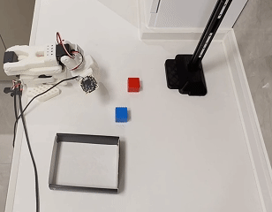

# π0.5 双视角机械臂抓取与顺序放置

**基于 SO-101 + LeRobot + OpenPI π0.5 的真机 VLA 操作**

示范采集 · 数据适配 · LoRA 联合微调 · 离线评估 · 云端 Guided RTC · 真机执行

    -green)

**目录：** [结果](#结果) · [方法](#方法) · [仓库结构](#仓库结构) · [运行](#运行) · [评测范围](#评测范围) · [致谢](#致谢)



*真机执行演示（1.5 倍速）。[下载完整演示视频](https://github.com/WHYNOT-18/so101-pi05-guided-rtc/releases/download/v1.0/demo.mp4)。*

基于双相机和关节状态，机械臂依次将红、蓝积木放入盒中。本地以 25 Hz 控制从臂，通过异步队列接收云端动作块，并使用 Guided RTC 衔接执行。

## 结果

| 指标 | 结果 |
| --- | --- |
| 正式真机测试 | **17/20成功，85%** |
| 示范数据 | 140条，55,999帧 |
| train / val / test | 100 / 20 / 20条 |
| 训练 / 最佳checkpoint | 10,000步 / 7,000步 |
| 最佳验证集loss | 0.010332 |
| 独立测试集loss | 0.009986，20条、8,000帧 |
| 正式测试请求往返P50 / P95 | **207.6 / 353.2 ms**，1,047次已接受请求 |
| 控制命令周期P50 / P95 | 40.22 / 40.30 ms |

成功判定为按先红后蓝顺序完成两块积木入盒，允许重抓、每轮不限时，由操作者人工判定。延迟不含相机采集等待和机器人执行。离线loss不代表真机成功率；验证与测试的batch size和精度协议不同，不作严格数值比较。

[真机结果](results/real_robot_test.json) · [离线测试](results/test_flow_loss.json) · [训练验证历史](results/training_validation.json)

正式20轮外部录像640×480，共24,172帧，已通过完整解码检查。

## 方法


- **数据**：双RGB相机640×480、30 FPS，采集循环25 Hz；按完整episode划分，种子42。原始数据保留，转换副本与训练集归一化独立管理。
- **适配**：front映射全局视角，wrist映射腕部视角；第三路空图且mask=False。输入224×224，6维状态和动作补齐至32维，动作块50步。前五个关节使用degree、夹爪使用LeRobot 0–100，均为绝对位置目标。
- **训练**：A800 80 GB，batch size 16；VLM LoRA rank/alpha均16，视觉编码器和原始语言骨干冻结，Action Expert全参数训练。每1000步保存并验证，6k后恢复优化器与采样顺序续训至10k。
- **部署**：RTX 5090云端推理，10步动作采样；SSH隧道内使用WebSocket + MessagePack。Guided RTC采用VJP soft inpainting，β=5，默认软前缀6步。
- **控制**：异步动作队列按实际消耗步数对齐，共同路径限速与4点平滑；巡航每20步重规划，预测夹爪开合变化时提前切换到最多8步反馈。正式评测使用raw图像传输。

完整参数见 [训练配置](configs/train_config.json)、[策略配置](configs/policy_config.json)。数据处理细节见 [data_pipeline.md](docs/data_pipeline.md)。

## 仓库结构

```text
.
├── assets/                       # 演示GIF（完整视频见Release）
├── configs/
│   ├── policy_config.json        # 输入输出与RTC配置
│   ├── train_config.json         # 两阶段训练参数
│   ├── split.json                # 固定划分索引
│   └── norm_stats.json           # 训练集归一化统计
├── docs/
│   └── data_pipeline.md          # 数据处理与环境说明
├── results/
│   ├── training_validation.json  # 10个checkpoint的验证结果
│   ├── test_flow_loss.json        # 独立离线测试
│   └── real_robot_test.json       # 20轮真机结果
├── scripts/
│   ├── data/                     # 转换、划分、适配与检查
│   ├── training/                 # 训练、续训、评估及公共配置
│   └── deployment/               # 云端RTC与本地异步控制
├── .gitignore
├── README.md
└── requirements.txt
```

数据集、模型权重、Python环境、完整日志及正式测试录像不包含在源码目录中。发布代码经过模块整理，原实验冻结版本保留本地；真机统计对应原实验版本。

## 运行

### 环境与运行目录

本地机器人与数据处理使用Python 3.12；云端训练与推理使用Python 3.11、JAX 0.5.3。`requirements.txt`对应本地CPU数据处理依赖，并继承已有机器人环境；云端需单独准备匹配GPU的JAX环境。

- OpenPI：`215abfb217dbac7d5f1273282331b9b1866c0479`。
- 数据兼容使用的LeRobot：`0cf864870cf29f4738d3ade893e6fd13fbd7cdb5`。
- 硬件接入另需支持当前SO-101接口的LeRobot、相机和Rerun环境。

脚本按用途收纳，运行前在仓库根目录恢复实验布局：

```bash
mkdir -p outputs/cloud_upload outputs/openpi_assets/pi05_so101_data/so101
cp scripts/data/*.py outputs/
cp scripts/training/*.py outputs/cloud_upload/
cp -a scripts/deployment/. outputs/
cp configs/norm_stats.json outputs/openpi_assets/pi05_so101_data/so101/
```

数据放到`outputs/datasets/`，固定版本源码与本地环境放到`work/`。迁移时修改Python路径、串口、相机编号、校准文件与云端目录。配置JSON记录实验参数，实际训练配置由`training_config.py`构建。

### 数据处理

原始v3.0数据就绪后，在含FFmpeg等依赖的环境中转换到一个不存在的新目录：

```bash
python outputs/convert_v3_to_v21.py \
  --source outputs/datasets/red_then_blue_v1 \
  --destination outputs/datasets/red_then_blue_v1_openpi_v21
```

现有转换结果不重复生成。划分以`configs/split.json`中的索引为准；原划分脚本另需实际布局标注。三个子集准备好后检查真实OpenPI加载：

```bash
work/openpi-env/bin/python outputs/process_openpi_dataset.py --batch-size 2 --batches 2
```

### 训练与离线测试

云端工作根目录默认`/root/autodl-tmp/so101`，需具备`envs/openpi/`、`openpi-src/`、`datasets/`、`cache/`、`openpi_assets/`、`models/verified_pi05/params/`。

将`scripts/training/*.py`放到云端工作根目录，将`so101_openpi.py`放到其`scripts/`目录。分词器放到`cache/openpi/big_vision/paligemma_tokenizer.model`，归一化放到`openpi_assets/pi05_so101_data/so101/norm_stats.json`。在云端工作根目录执行：

```bash
envs/openpi/bin/python -u train_so101_6000.py --batch-size 16
envs/openpi/bin/python -u continue_so101_10000.py \
  --resume-exp "$EXP_NAME" --expected-step 6000 --batch-size 16
envs/openpi/bin/python -u evaluate_so101_test.py \
  --checkpoint "$CHECKPOINT" --batch-size 1
```

`EXP_NAME`为初始训练生成的实验名，`CHECKPOINT`为所选模型目录。

### 云端RTC与本地控制

将`scripts/deployment/cloud_upload/`下的`so101_rtc/`与`so101_remote/`放到云端工作根目录，保持两者相邻。云端启动：

```bash
envs/openpi/bin/python -I -u so101_rtc/serve_guided_rtc.py \
  --checkpoint "$CHECKPOINT" --beta 5 --soft-prefix-steps 6
```

等待`GUIDED RTC READY`后，在本机另开终端，替换实际SSH信息：

```bash
ssh -C -N -T -o ExitOnForwardFailure=yes \
  -L 127.0.0.1:18000:127.0.0.1:8000 \
  -p <SSH_PORT> <SSH_USER>@<SSH_HOST>
```

下面命令会驱动真实机械臂，执行前需完成校准、端口与相机确认：

```bash
work/openpi-env/bin/python -I -u outputs/run_async_rtc.py \
  --execute --guidance on --port /dev/ttyACM0 --front 4 --wrist 6 \
  --joint-speed 60 --gripper-speed 100 \
  --replan-steps 20 --anticipate-grasp --rtc-min-delay 8 \
  --smoothing-window 4 --image-codec raw --seconds 0
```

按Ctrl+C停止，退出时发送当前位置保持指令；断电前应托住机械臂。

## 评测范围

本项目完成了数据加载、联合微调、独立离线测试、云端动作采样与20轮真机评测。尚未进行系统性ID/OOD测试或固定条件下的RTC消融，因此不宣称RTC带来了特定的成功率增益、跳变降幅或任务耗时改善。

## 致谢

[OpenPI](https://github.com/Physical-Intelligence/openpi) · [LeRobot](https://github.com/huggingface/lerobot) · [Rerun](https://github.com/rerun-io/rerun)
